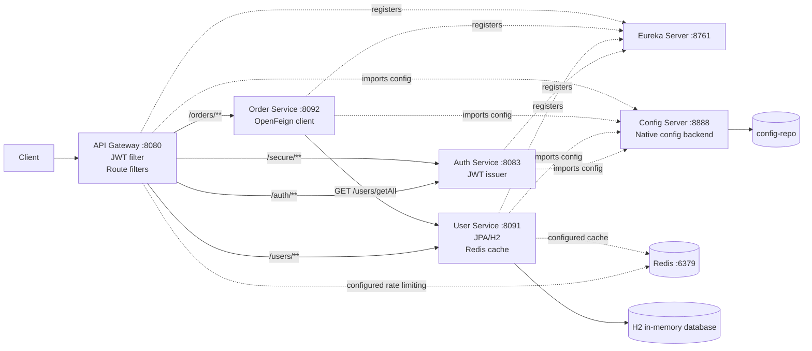

# Microservices JWT Gateway

An educational Spring Boot microservices demonstration showing API Gateway routing, JWT validation, Eureka discovery, centralized configuration, Redis integration, H2/JPA persistence, and OpenFeign communication.

This repository is intentionally small and practical. It is a learning project, not an enterprise production platform.

## What this project demonstrates

The verified request flow is:

```text
Client -> API Gateway -> JWT validation -> User or Order Service
                                      \-> Auth Service
Order Service -> OpenFeign -> User Service
```

Supporting infrastructure:

- Eureka Server for service registration and discovery.
- Config Server for centralized YAML configuration.
- Redis dependencies for the configured gateway rate limiter and User Service cache.
- H2/JPA persistence in User Service.

See the [architecture diagram](docs/architecture.mmd) and [API documentation](docs/api-docs.md).

## Services and ports

| Component | Port | Responsibility |
|---|---:|---|
| API Gateway | 8080 | Routes requests, validates JWTs for protected paths, adds the verified username header, and defines rate-limit filters. |
| Auth Service | 8083 | Checks the configured demonstration credentials and issues an HMAC JWT. |
| User Service | 8091 | Reads users from JPA/H2 and exposes a fixed demonstration user list; Redis cache configuration is present. |
| Order Service | 8092 | Returns a fixed demonstration order and calls User Service with OpenFeign. |
| Config Server | 8888 | Serves configuration from the checked-out `config-repo` by default. |
| Eureka Server | 8761 | Service registry used by discovery-aware clients. |
| Redis | 6379 | Intended backend for gateway rate limiting and User Service caching. |

The application source is split into independent Maven projects. There is no root Maven reactor build.

## Architecture



The diagram describes declared source/configuration wiring. Docker startup and live API behavior have not been verified in the current environment.

## Repository structure

```text
API-Gateway/       Reactive Spring Cloud Gateway and JWT filter
auth-service/      Demonstration login and JWT generation
user-service/      User controller, JPA entity/repository, Redis cache config
order-service/     Order endpoint and User Service Feign client
Eureka-Server/     Eureka registry
config-server/     Spring Cloud Config Server
config-repo/       Centralized YAML configuration
docs/              Developer documentation and API examples
postman/           Postman collection
docker-compose.yml Docker service definitions
run-all.bat        Windows local startup helper
```

## Prerequisites

For local JVM execution:

- Java 17 or newer.
- A working Maven installation, or the Maven Wrapper in each module.
- Redis available on `localhost:6379`.

For Docker execution:

- Docker Desktop with the Linux engine available.
- Docker Compose v2 or newer.

## Environment configuration

Copy `.env.example` to `.env` for local Compose use, then replace the placeholders locally. Never commit `.env`.

Required values:

```dotenv
JWT_SECRET=replace-with-a-local-secret-at-least-32-bytes
JWT_EXPIRATION=3600000
AUTH_ADMIN_USERNAME=replace-me
AUTH_ADMIN_PASSWORD=replace-me
```

The same `JWT_SECRET` must be supplied to Auth Service and API Gateway. The source validates the configured secret at startup. The example file contains placeholders only.

## Local JVM startup

The default Config Server profile is native and reads `../config-repo` relative to the `config-server` working directory.

1. Start Redis on `localhost:6379`.
2. Export or set the four environment variables from `.env.example`.
3. Start Eureka Server on port `8761`.
4. Start Config Server on port `8888`.
5. Start Auth Service on port `8083`.
6. Start User Service on port `8091`.
7. Start Order Service on port `8092`.
8. Start API Gateway on port `8080`.

From each module directory, run:

```powershell
.\mvnw.cmd spring-boot:run
```

The repository also contains `run-all.bat`, which starts Redis through Docker Compose and opens separate Windows command windows for the Java services. It is a convenience script, not a readiness orchestrator; verify Eureka and Config Server readiness before sending requests.

## Docker Compose startup

1. Ensure Docker Desktop's Linux engine is running.
2. Copy `.env.example` to `.env` and replace placeholders locally.
3. From the repository root, validate the Compose model:

```powershell
docker compose config
```

4. Build and start the stack:

```powershell
docker compose up --build
```

5. Stop the stack with:

```powershell
docker compose down
```

Compose builds six Java images and starts Redis. Its `depends_on` entries express container start ordering only; they do not prove that Eureka or Config Server is ready. Docker image build and runtime startup are not claimed as verified in the current development environment.

## Authentication and API usage

The login endpoint is exposed through the Gateway at `POST /auth/login`. It accepts request parameters, not JSON:

```bash
curl -X POST "http://localhost:8080/auth/login?username=YOUR_USERNAME&password=YOUR_PASSWORD"
```

The response is a raw JWT string. Use it as a bearer token for protected Gateway paths:

```bash
curl -H "Authorization: Bearer YOUR_JWT" \
  http://localhost:8080/users/getAll
```

See [docs/api-docs.md](docs/api-docs.md) for the complete source-derived endpoint list and response examples. A matching Postman collection is in [postman/microservices-jwt-gateway.postman_collection.json](postman/microservices-jwt-gateway.postman_collection.json).

## Security boundaries and limitations

- `/auth/**` is public at the Gateway.
- `/users/**`, `/orders/**`, and `/secure/**` require a syntactically valid, non-expired JWT at the Gateway.
- Unknown Gateway paths are rejected by the custom filter.
- Auth Service itself currently permits non-`/auth/**` requests in its Spring Security configuration; direct service access can therefore bypass Gateway JWT enforcement. Do not expose internal service ports as a security boundary.
- The demonstration uses one configured credential pair, not a user database or password hashing workflow.
- JWT roles/authorities, refresh tokens, revocation, and key rotation are not implemented.
- User Service `getAll` returns a fixed list; the JPA repository is used by the ID lookup path.
- Order Service returns a fixed demonstration order and enriches it through Feign.
- H2 is in-memory and data is lost on restart.
- The current centralized Gateway Redis YAML placement should be reviewed before relying on live rate limiting; this documentation does not claim rate limiting has been runtime-verified.

## Testing status

Each module contains a context-load test. The test classes now explicitly identify their application classes and isolate Config Server/Eureka properties. In the current environment, contexts start but Surefire does not terminate cleanly, so completed passing test results are not claimed.

The latest validated build result is Maven packaging with tests skipped for all six modules. See [docs/known-limitations.md](docs/known-limitations.md).

## License

This project is released under the [MIT License](LICENSE).

## Contributing

See [CONTRIBUTING.md](CONTRIBUTING.md) for documentation and code contribution guidance.
